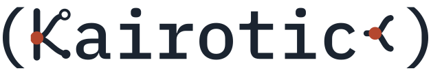

<h1><picture>
  <source media="(prefers-color-scheme: dark)" srcset="brand/kairotic-logo-dark.svg">
  
</picture></h1>

*[Read in English](README.md)* · **0.3.0-alpha** · [abrir la app](https://bonuoq.github.io/kairotic/) · [documentación](docs/README.es.md)

Un espacio colaborativo visual-acústico para improvisación, composición e interpretación musical:
un patcher donde **código y patch son la misma obra**, con una historia ramificada y compartida,
lienzos de frecuencia sobre tiempo, partituras, cajas de código (Faust, ClojureScript) y
componentes que cualquiera puede escribir y compartir.

*kairos* + *chaotic*: el momento oportuno y la divergencia de líneas temporales.

## Principios

- **Datos primero.** La obra es EDN; cada gesto es un evento que se escribe como código.
- **Dos vistas, una obra.** Código (REPL al estilo CAC) y patch (su representación gráfica).
- **Historia ramificada y colaborativa.** Un árbol de eventos; se bifurca ante gestos simultáneos o vueltas atrás, y las ramas se pueden mezclar.
- **Representación y lectura separadas.** Un lienzo es solo frecuencia sobre tiempo; su organización temporal la da quien lo lee.
- **Componentes.** Cada clase de caja es un mapa de datos y funciones con un contrato común, escrito por secciones: argumentos, lógica y una vista hecha de datos.
- **Estático.** ClojureScript interpretado con [Scittle](https://github.com/babashka/scittle) (sin compilar), dependencias desde CDN y WebAssembly (Faust, Verovio).

## Usarlo

- **[Abre la app](https://bonuoq.github.io/kairotic/)** (Kairotic Pages): obras solo y salas en GUN,
  Claude con tu propia clave de API de Anthropic. Dentro de claude.ai, el artefacto de Kairotic hace lo
  mismo con tu cuenta de claude.ai.
- Empieza por la **[Guía](docs/guide.es.md)** y luego los [Conceptos](docs/concepts.es.md); la pestaña Help
  tiene los tutoriales y una página para cada clase ([referencia](docs/reference.md)).
- Comparte lo que hagas con Claude en la
  [Gallery](https://github.com/bonuoq/kairotic/discussions/categories/gallery); ideas y preguntas en
  [Discussions](https://github.com/bonuoq/kairotic/discussions).

## Estructura

```
app/                  la app: index.html (interfaz y estilos) y page/*.cljs (el ClojureScript de la página, en orden)
core/kairotic/        los módulos: componentes, motor, canvas, partitura, mt (árboles musicales), enlaces, asistente (Claude)…
core/backends/        el backend GUN de Pages (db, salas, usuario, Claude con tu propia clave)
site/                 la edición Pages: build.mjs, configuración (relays), GUN, la página de prueba de embeds
packages/             los paquetes oficiales de componentes, @kairotic/* (ver abajo)
examples/             el catálogo que Claude lee cuando escribe
docs/                 documentación (inglés y castellano), tutoriales, referencia de clases generada
tests/                pruebas (cljs/*.cljs), en el navegador (tests.html) y en CI
relay/                un relay GUN para las salas
studies/              los ensayos (01–70), cada uno tal como se publicó; studies/_shared, lo que comparten
components/           el paquete npm obsoleto kairotic-components (ensayos 9–23), sustituido por @kairotic/controls
componentes/          el paquete anterior (kairotic-componentes, ensayos 7–8), sustituido por kairotic-components
```

## Paquetes oficiales

Todos publicados en npm bajo el ámbito `@kairotic`, MPL-2.0, desde este repositorio:

| Paquete | Qué es |
|---|---|
| [`@kairotic/app`](app/) | la app como archivos, que el shell de claude.ai carga desde jsDelivr |
| [`@kairotic/relay`](relay/) | un relay GUN para las salas y las obras guardadas, con un puente OSC y un reloj compartido |
| [`@kairotic/synth`](packages/synth/) | síntesis: `adsr~`, `synth~`, `gendy~` (a partir de Xenakis), `click~` |
| [`@kairotic/spatial`](packages/spatial/) | espacio: `pan~`, `space~` (binaural) |
| [`@kairotic/controls`](packages/controls/) | controles con vista propia: `knob`, `keyboard`, `scale` |
| [`@kairotic/analysis`](packages/analysis/) | escucha: `features~`, `pitch~`, `onset~`, `chroma~`, `spectrum~`, `transcribe`, `follow`, `form~`, `monitor` |
| [`@kairotic/data`](packages/data/) | datos de fuera: `fetch`, `edn` |
| [`@kairotic/theory`](packages/theory/) | vistas de teoría: `pcclock`, `fourier`, `tonnetz` |
| [`@kairotic/cac`](packages/cac/) | composición asistida: `cac` (partimento, judge), `comes` (contrapunto en vivo) y los núcleos compartidos |
| [`@kairotic/rules`](packages/rules/) | un único motor de restricciones para todos los estilos: reglas, catálogo y estilos (sin cajas) |
| [`@kairotic/rhythm`](packages/rhythm/) | el ritmo como geometría: `necklace`, `euclid`, `chance`, `homometric`, `swap`, `morph`, `vary`, `phase` |
| [`@kairotic/patterns`](packages/patterns/) | patterns a la manera de SuperCollider: `pbind`, `pattern`, `player`, `render` |
| [`@kairotic/spectral`](packages/spectral/) | procesos espectrales: `shift~` (stftPitchShift en WebAssembly) |
| [`@kairotic/io`](packages/io/) | el mundo exterior: MIDI (con MPE), OSC, movimiento, mandos, puerto serie, `control` |
| [`@kairotic/net`](packages/net/) | una sala compartida: `share`, `shared`, `pulse` |
| [`@kairotic/faust-units`](packages/faust-units/) | Faust como cajas unitarias, sincronizadas con el código, y la receta de un `faust~` (sin cajas) |

Las clases y sus argumentos están en [`packages/`](packages/README.es.md) y en la ayuda de la app.

## Desarrollo

Kairotic es estático: ClojureScript interpretado por [Scittle](https://github.com/babashka/scittle) en el
navegador, sin compilador. Para construirlo y servirlo en local:

```sh
node site/build.mjs                 # → _site/ (edición Pages) y _artifact/ (edición claude.ai)
cd _site && python3 -m http.server 8000
# http://localhost:8000              la app
# http://localhost:8000/tests.html   las pruebas
```

`site/build.mjs` construye primero los paquetes, los ejemplos de Claude y los
tutoriales. En cada push, GitHub Actions despliega Pages, ejecuta las pruebas en un Chromium sin
pantalla y regenera [docs/reference.md](docs/reference.md) a partir de la ayuda. Ver los
[cambios](CHANGELOG.md).

## Contribuir

Kairotic está abierto a contribuciones: componentes, ensayos, documentación, traducciones, pruebas, avisos de errores.

- **[Contribuir](CONTRIBUTING.es.md)**: cómo montar el entorno, correr las pruebas, las convenciones del
  proyecto y el [DCO](https://developercertificate.org/) (cada commit firmado: `git commit -s`).
- Las **ideas** van a [Discussions](https://github.com/bonuoq/kairotic/discussions/categories/ideas);
  los **errores**, a [Issues](https://github.com/bonuoq/kairotic/issues).
- **[Hoja de ruta](ROADMAP.es.md)**: lo que viene después de la 0.3.0.
- **[Cómo se construye Kairotic](docs/how-kairotic-is-built.es.md)**: dirección humana, Claude Code como el
  asistente que escribe gran parte del código, y lo que eso significa para ti.
- [Código de conducta](CODE_OF_CONDUCT.es.md) · [Seguridad](SECURITY.md)

## Componentes

Ver [Escribir un componente](docs/writing-a-component.es.md) y [`packages/`](packages/README.es.md). Los
paquetes oficiales llegan solos a una obra cuando una caja usa una de sus clases (`knob` trae
`@kairotic/controls`); cualquier componente o paquete publicado se importa con
`(import! "npm:@kairotic/controls@0.1.0/dist/index.mjs")`.

## Licencias y créditos

- **Código** (núcleo, ensayos, scripts y componentes oficiales): [Mozilla Public License 2.0](LICENSE).
  Es un copyleft por archivo: quien distribuya Kairotic modificado comparte sus cambios en estos
  archivos, mientras que los componentes, las obras y lo que se construya alrededor pueden llevar la
  licencia que quieran sus autores.
- **Documentación** (estos README y los documentos del proyecto):
  [CC BY-SA 4.0](https://creativecommons.org/licenses/by-sa/4.0/deed.es).
- **Las obras son de quien las crea.** Kairotic no impone ninguna licencia a las obras, patches,
  lienzos, partituras ni componentes que se hagan con él.
- **Componentes de la comunidad:** cada definición declara su licencia con `:license` (identificador
  [SPDX](https://spdx.org/licenses/)); al importarla, la licencia queda en la cabecera de la copia.

### Dependencias

**Se cargan desde CDN** (jsDelivr) cuando la app las necesita, fijadas a una versión; no están en el repositorio:

| | Versión | Licencia | Para qué |
|---|---|---|---|
| [Scittle](https://github.com/babashka/scittle) (SCI) | 0.7.30 | EPL-1.0 | interpretar el ClojureScript de la página y de las cajas |
| [DataScript](https://github.com/tonsky/datascript) | 1.8.1 | EPL-1.0 | consultas Datalog sobre la historia (se carga con la primera consulta) |
| [Verovio](https://www.verovio.org) (toolkit en WebAssembly) | 5.7.0 | LGPL-3.0-or-later | grabar partituras (MEI) |
| [faustwasm](https://github.com/grame-cncm/faustwasm) (`@grame/faustwasm`) | 0.18.5 | LGPL-3.0 | compilar las cajas `faust~` en el navegador; lleva las librerías de Faust |
| [Meyda](https://meyda.js.org) | 5.6.3 | MIT | descriptores de audio (`@kairotic/analysis`, la receta de un `faust~`) |
| [IBM Plex](https://github.com/IBM/plex) Sans, Sans Condensed, Mono (vía Google Fonts) | — | OFL-1.1 | tipografías |
| los paquetes oficiales `@kairotic/*` | la suya | MPL-2.0 | llegan a una obra en la versión que fija |

**Incluidas en el repositorio** (empaquetadas o copiadas, con sus licencias):

| | Versión | Licencia | Dónde |
|---|---|---|---|
| [CodeMirror 6](https://codemirror.net) y [Lezer](https://lezer.codemirror.net) (`@codemirror/*`, `@lezer/*`) | state 6.7.6, view 6.43.14, language 6.13.1, commands 6.11.1, autocomplete 6.20.3, search 6.7.2, lint 6.9.7, lang-markdown 6.0.0; Lezer common 1.5.3, lr 1.4.11, highlight 1.2.5, markdown 1.8.0 | MIT | el editor de código, empaquetado en `core/vendor/codemirror.mjs` ([lock](core/vendor/codemirror/package-lock.json)) |
| [clojure-mode](https://github.com/nextjournal/clojure-mode) (`@nextjournal/clojure-mode`) | 0.3.3 | EPL-2.0 | la edición de Clojure en ese paquete |
| [lezer-clojure](https://github.com/nextjournal/lezer-clojure) (`@nextjournal/lezer-clojure`) | 1.0.0 | ISC | la gramática de Clojure, en ese paquete |
| [squint](https://github.com/squint-cljs/squint) (`squint-cljs`, su runtime) | 0.7.111 | EPL-1.0 | lo usa clojure-mode, en ese paquete |
| [GUN](https://gun.eco) (`gun.js`, `sea.js`, `lib/radix`, `radisk`, `store`, `rindexed`) | commit `054ca85` (0.2020.1239) | MIT OR Zlib OR Apache-2.0 | salas y obras guardadas en Pages: [`site/vendor/gun/`](site/vendor/gun/VERSION.md); el relay instala el mismo commit |
| [stftPitchShift](https://github.com/jurihock/stftPitchShift) (Jürgen Hock) | 2.0 | MIT | compilado a WebAssembly dentro de `@kairotic/spectral` (`shift~`) |
| [GendyJS](https://github.com/abbernie/gendy) (Andrew Bernstein) | — | MIT | portado al worklet de `gendy~` en `@kairotic/synth` |

**Solo en algunos ensayos:** [thi.ng/geom](https://thi.ng/geom) 8.3.35 (Apache-2.0, Ensayo 24, desde jsDelivr);
los obsoletos `kairotic-componentes` 0.2.0 y `kairotic-components` 0.1.2 (MPL-2.0, ensayos 7–23).

**Datos:** las frases de los 370 corales de Bach ([`studies/_shared/chorales/`](studies/_shared/chorales/README.md)),
cortadas de [la edición Humdrum de Craig Sapp](https://github.com/craigsapp/bach-370-chorales): **CC BY-NC-SA 4.0**,
no MPL-2.0 (no comercial; ver su `LICENSE.md`).

**El relay** (`@kairotic/relay`, se instala con npm): GUN en el mismo commit y
[ws](https://github.com/websockets/ws) ^7.5.10 (MIT).

**Solo para construir y probar** (no se distribuyen): [esbuild](https://esbuild.github.io) ^0.28 (MIT, el
paquete del editor), [wasi-sdk](https://github.com/WebAssembly/wasi-sdk) (Apache-2.0 WITH LLVM-exception, el
WebAssembly de `shift~`), [Playwright](https://playwright.dev) 1.56.0 (Apache-2.0) y
[http-server](https://github.com/http-party/http-server) 14 (MIT) en CI.

**Servicios:** jsDelivr y Google Fonts sirven los archivos de arriba; a Claude se llega con **tu propia**
clave de API de Anthropic en Pages (o con tu propia cuenta de claude.ai dentro de claude.ai); las salas
pasan por un relay GUN (el del sitio, `kairotic-relay.onrender.com`, o el tuyo).

El código Faust que se escribe en una caja `faust~` puede usar las
[librerías de Faust](https://faustlibraries.grame.fr/); cada función declara su licencia, y quien
distribuya una obra debe respetar las de las funciones que use.

### Inspiración

Ideas, no código: [DSim](https://github.com/helins/dsim.cljc) (estado y tiempo como datos),
[editscript](https://github.com/juji-io/editscript), [INScore](https://inscore.grame.fr/) (relación
tiempo ⇄ espacio), [bach](https://www.bachproject.net/) (partituras como objetos del patch),
[JSPatcher](https://github.com/Fr0stbyteR/jspatcher), [OSSIA score](https://ossia.io/),
[Oscilla](https://oscilla.app), [Scala](https://www.huygens-fokker.org/scala/) (formato de afinaciones),
OpenMusic, Opusmodus, FOMUS y la tradición LISP de la composición asistida.
