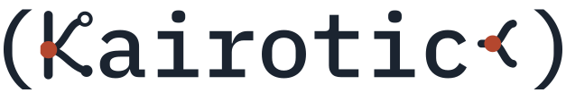

<h1><picture>
  <source media="(prefers-color-scheme: dark)" srcset="brand/kairotic-logo-dark.svg">
  
</picture></h1>

*[Leer en castellano](README.es.md)* · **0.3.0-alpha** · [open the app](https://bonuoq.github.io/kairotic/) · [documentation](docs/README.md)

A collaborative visual-acoustic space for musical improvisation, composition and performance:
a patcher where **code and patch are the same work**, with a branching, shared history, an EDN tree for extensible musical notation, Verovio integration, different graphical representations, DSP, code boxes (Faust, ClojureScript) and components
that anyone can write and share.

*kairos* + *chaotic*: the opportune moment and the divergence of timelines.

## Principles

- **Data first.** A work is EDN; every gesture is an event written as code.
- **Two views, one work.** Code (a REPL in the CAC tradition) and patch (its graphic representation).
- **Branching, collaborative history.** A tree of events; it branches on simultaneous gestures or going back, and branches can be merged.
- **Representation and reading are separate.** A canvas is only frequency over time; whoever reads it gives it a temporal organisation.
- **Components.** Every box class is a map of data and functions with a common contract, written in sections: arguments, logic and a view made of data.
- **Static.** ClojureScript interpreted with [Scittle](https://github.com/babashka/scittle) (no compiler), dependencies from a CDN and WebAssembly (Faust, Verovio).

## Using it

- **[Open the app](https://bonuoq.github.io/kairotic/)** (Kairotic Pages): solo works and rooms in GUN,
  Claude with your own Anthropic API key. Inside claude.ai, the Kairotic artifact does the same with your
  claude.ai account.
- Start with the **[Guide](docs/guide.md)**, then [Concepts](docs/concepts.md); the Help tab has the
  tutorials and a page for every class ([reference](docs/reference.md)).
- Share what you make with Claude in the
  [Gallery](https://github.com/bonuoq/kairotic/discussions/categories/gallery); ideas and questions in
  [Discussions](https://github.com/bonuoq/kairotic/discussions).

## Layout

```
app/                  the app: index.html (interface and styles) and page/*.cljs (the page's ClojureScript, in order)
core/kairotic/        the modules: components, engine, canvas, score, mt (musical trees), links, assistant (Claude)…
core/backends/        the GUN backend for Pages (db, rooms, user, Claude with your own key)
site/                 the Pages edition: build.mjs, configuration (relays), GUN, the embed test page
packages/             the official component packages, @kairotic/* (see below)
examples/             the catalog Claude reads when it writes
docs/                 documentation (English and Spanish), tutorials, generated class reference
tests/                tests (cljs/*.cljs), run in the browser (tests.html) and in CI
relay/                a GUN relay for rooms
studies/              the studies from 24 on, each as it was published; studies/_shared, what they share
```

## Official packages

All published on npm under the `@kairotic` scope, MPL-2.0, from this repository:

| Package | What it is |
|---|---|
| [`@kairotic/app`](app/) | the app as files, loaded from jsDelivr by the claude.ai shell |
| [`@kairotic/relay`](relay/) | a GUN relay for rooms and saved works, with an OSC bridge and a shared clock |
| [`@kairotic/synth`](packages/synth/) | synthesis: `adsr~`, `synth~`, `gendy~` (after Xenakis), `click~` |
| [`@kairotic/spatial`](packages/spatial/) | space: `pan~`, `space~` (binaural) |
| [`@kairotic/controls`](packages/controls/) | controls with their own views: `knob`, `keyboard`, `scale` |
| [`@kairotic/analysis`](packages/analysis/) | listening: `features~`, `pitch~`, `onset~`, `chroma~`, `spectrum~`, `transcribe`, `follow`, `form~`, `monitor` |
| [`@kairotic/data`](packages/data/) | data from outside: `fetch`, `edn` |
| [`@kairotic/theory`](packages/theory/) | theory views: `pcclock`, `fourier`, `tonnetz` |
| [`@kairotic/cac`](packages/cac/) | computer-assisted composition: `cac` (partimento, judge), `comes` (live counterpoint) and the shared kernels |
| [`@kairotic/rules`](packages/rules/) | one constraint engine for every style: rules, catalogue and styles (no boxes) |
| [`@kairotic/rhythm`](packages/rhythm/) | rhythm as geometry: `necklace`, `euclid`, `chance`, `homometric`, `swap`, `morph`, `vary`, `phase` |
| [`@kairotic/patterns`](packages/patterns/) | patterns after SuperCollider: `pbind`, `pattern`, `player`, `render` |
| [`@kairotic/spectral`](packages/spectral/) | spectral processing: `shift~` (stftPitchShift in WebAssembly) |
| [`@kairotic/io`](packages/io/) | the outside world: MIDI (with MPE), OSC, motion, gamepads, serial, `control` |
| [`@kairotic/net`](packages/net/) | a shared room: `share`, `shared`, `pulse` |
| [`@kairotic/faust-units`](packages/faust-units/) | Faust as unit boxes, kept in sync with the code, and the recipe of a `faust~` (no boxes) |

The classes and their arguments are in [`packages/`](packages/README.md) and in the app's Help.

## Development

Kairotic is static: ClojureScript interpreted by [Scittle](https://github.com/babashka/scittle) in the
browser, no compiler. Build and serve it locally:

```sh
node site/build.mjs                 # → _site/ (Pages edition) and _artifact/ (claude.ai edition)
cd _site && python3 -m http.server 8000
# http://localhost:8000          the app
# http://localhost:8000/tests.html   the tests
```

`site/build.mjs` builds the packages, Claude's examples and the tutorials first. On every
push, GitHub Actions deploys Pages, runs the tests in a headless Chromium, and regenerates
[docs/reference.md](docs/reference.md) from the help. See the [Changelog](CHANGELOG.md).

## Contributing

Kairotic is open to contributions: components, studies, documentation, translations, tests, bug reports.

- **[Contributing](CONTRIBUTING.md)**: setting up, running the tests, the project's conventions, and the
  [DCO](https://developercertificate.org/) (every commit signed off: `git commit -s`).
- **Ideas** go to [Discussions](https://github.com/bonuoq/kairotic/discussions/categories/ideas);
  **bugs** to [Issues](https://github.com/bonuoq/kairotic/issues).
- **[Roadmap](ROADMAP.md)**: what comes after 0.3.0.
- **[How Kairotic is built](docs/how-kairotic-is-built.md)**: human direction, Claude Code as the assistant
  that writes much of the code, and what that means for you.
- [Code of Conduct](CODE_OF_CONDUCT.md) · [Security](SECURITY.md)

## Components

See [Writing a component](docs/writing-a-component.md) and [`packages/`](packages/README.md). Official
packages come into a work by themselves when a box uses one of their classes (`knob` brings
`@kairotic/controls`); any published component or package is imported with
`(import! "npm:@kairotic/controls@0.1.0/dist/index.mjs")`.

## Licences and credits

- **Code** (core, studies, scripts and official components): [Mozilla Public License 2.0](LICENSE).
  It is a file-level copyleft: whoever distributes a modified Kairotic shares their changes to these
  files, while components, works and anything built around them can carry whatever licence their
  authors choose.
- **Documentation** (these READMEs and the project documents):
  [CC BY-SA 4.0](https://creativecommons.org/licenses/by-sa/4.0/).
- **Data under other licences** stays apart, with its own `LICENSE.md`: Bach's chorales corpus
  (`studies/_shared/chorales/`, CC BY-NC-SA 4.0, non-commercial) is used by the studies and never by the app,
  the packages or the relay ([tests/licences.mjs](tests/licences.mjs) checks it).
- **Works belong to whoever creates them.** Kairotic imposes no licence on the works, patches,
  canvases, scores or components made with it.
- **Community components:** every definition declares its licence with `:license` (an
  [SPDX](https://spdx.org/licenses/) id); when imported, the licence stays in the header of the copy.

### Dependencies

**Loaded from a CDN** (jsDelivr) when the app needs them, pinned to a version; not in the repository:

| | Version | Licence | Used for |
|---|---|---|---|
| [Scittle](https://github.com/babashka/scittle) (SCI) | 0.7.30 | EPL-1.0 | interpreting the ClojureScript of the page and of the boxes |
| [DataScript](https://github.com/tonsky/datascript) | 1.8.1 | EPL-1.0 | Datalog queries over the history (loaded on the first query) |
| [Verovio](https://www.verovio.org) (toolkit in WebAssembly) | 5.7.0 | LGPL-3.0-or-later | engraving scores (MEI) |
| [faustwasm](https://github.com/grame-cncm/faustwasm) (`@grame/faustwasm`) | 0.18.5 | LGPL-3.0 | compiling `faust~` boxes in the browser; carries the Faust libraries |
| [Meyda](https://meyda.js.org) | 5.6.3 | MIT | audio descriptors (`@kairotic/analysis`, the recipe of a `faust~`) |
| [IBM Plex](https://github.com/IBM/plex) Sans, Sans Condensed, Mono (via Google Fonts) | — | OFL-1.1 | typefaces |
| the official `@kairotic/*` packages | their own | MPL-2.0 | brought into a work at the version it pins |

**Included in the repository** (bundled or vendored, with their licences):

| | Version | Licence | Where |
|---|---|---|---|
| [CodeMirror 6](https://codemirror.net) and [Lezer](https://lezer.codemirror.net) (`@codemirror/*`, `@lezer/*`) | state 6.7.6, view 6.43.14, language 6.13.1, commands 6.11.1, autocomplete 6.20.3, search 6.7.2, lint 6.9.7, lang-markdown 6.0.0; Lezer common 1.5.3, lr 1.4.11, highlight 1.2.5, markdown 1.8.0 | MIT | the code editor, bundled into `core/vendor/codemirror.mjs` ([lock file](core/vendor/codemirror/package-lock.json)) |
| [clojure-mode](https://github.com/nextjournal/clojure-mode) (`@nextjournal/clojure-mode`) | 0.3.3 | EPL-2.0 | Clojure editing in that bundle |
| [lezer-clojure](https://github.com/nextjournal/lezer-clojure) (`@nextjournal/lezer-clojure`) | 1.0.0 | ISC | Clojure grammar, in that bundle |
| [squint](https://github.com/squint-cljs/squint) (`squint-cljs`, its runtime) | 0.7.111 | EPL-1.0 | used by clojure-mode, in that bundle |
| [GUN](https://gun.eco) (`gun.js`, `sea.js`, `lib/radix`, `radisk`, `store`, `rindexed`) | commit `054ca85` (0.2020.1239) | MIT OR Zlib OR Apache-2.0 | rooms and saved works in Pages: [`site/vendor/gun/`](site/vendor/gun/VERSION.md); the relay installs the same commit |
| [stftPitchShift](https://github.com/jurihock/stftPitchShift) (Jürgen Hock) | 2.0 | MIT | compiled to WebAssembly inside `@kairotic/spectral` (`shift~`) |
| [GendyJS](https://github.com/abbernie/gendy) (Andrew Bernstein) | — | MIT | ported to the `gendy~` worklet in `@kairotic/synth` |

**Only in a study:** [thi.ng/geom](https://thi.ng/geom) 8.3.35 (Apache-2.0, Study 24, from jsDelivr).

**Data:** the phrases of Bach's 370 chorales ([`studies/_shared/chorales/`](studies/_shared/chorales/README.md)), cut
from [Craig Sapp's Humdrum edition](https://github.com/craigsapp/bach-370-chorales): **CC BY-NC-SA 4.0**, not
MPL-2.0 (non-commercial; see its `LICENSE.md`).

**The relay** (`@kairotic/relay`, installed with npm): GUN at the same commit and
[ws](https://github.com/websockets/ws) ^7.5.10 (MIT).

**To build and test only** (not shipped): [esbuild](https://esbuild.github.io) ^0.28 (MIT, the editor bundle),
[wasi-sdk](https://github.com/WebAssembly/wasi-sdk) (Apache-2.0 WITH LLVM-exception, the WebAssembly of
`shift~`), [Playwright](https://playwright.dev) 1.56.0 (Apache-2.0) and
[http-server](https://github.com/http-party/http-server) 14 (MIT) in CI.

**Services:** jsDelivr and Google Fonts serve the files above; Claude is reached with **your own**
Anthropic API key in Pages (or your own claude.ai account inside claude.ai); rooms go through a GUN relay
(the site's, `kairotic-relay.onrender.com`, or your own).

Faust code written in a `faust~` box can use the [Faust libraries](https://faustlibraries.grame.fr/);
every function declares its licence, and whoever distributes a work must respect those of the
functions it uses.

### Inspiration

Ideas, not code: [DSim](https://github.com/helins/dsim.cljc) (state and time as data),
[editscript](https://github.com/juji-io/editscript), [INScore](https://inscore.grame.fr/) (time ⇄ space),
[bach](https://www.bachproject.net/) (scores as patch objects),
[JSPatcher](https://github.com/Fr0stbyteR/jspatcher), [OSSIA score](https://ossia.io/),
[Oscilla](https://oscilla.app), [Scala](https://www.huygens-fokker.org/scala/) (tuning format),
OpenMusic, Opusmodus, FOMUS and the LISP tradition of computer-assisted composition.
